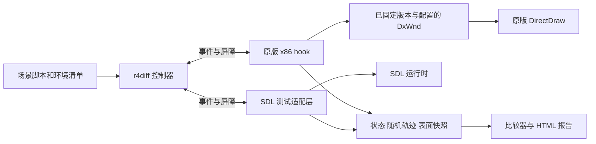

# 原版与 SDL 逐帧差异测试工具设计

采用一个控制器、原版 x86 hook DLL 和 SDL 测试适配层，让两边消费同一份虚拟时间、输入和外部事件，逐步比较随机轨迹、游戏状态与画面。DxWnd 继续提供原版的 DirectDraw 兼容支持；它造成的实际等待时间不参与确定性测试的游戏时钟。另设真实时钟诊断模式，定位拖慢来源。

本设计面向当前 Rich4 二进制和 SDL 1.2 项目。第一阶段观察工具及第二阶段双端锁步工具已实现；下面仍包含后续完整覆盖的设计目标，实际命令和支持边界以 [工具说明](../tools/frame_diff/README.md) 为准。第二阶段实测见 [验证记录](evidence/lockstep-phase2-2026-10-22.md)。交付目标是可复现的差异证据，不能通过强制改写状态、跳过随机调用或自动错帧配对获得通过结果。

## 当前代码依据

原版文件 `assets/original/Rich4.exe` 的 SHA256 为 `5a90aee28ee5f7a5c3ba5cb935c9e55751a529c25fcd91208748a66293569550`，IDA 基址为 `0x400000`。下表地址只适用于这个版本，运行时使用 `module_base + RVA`，并检查代码字节及所在模块。新查证的反编译记录见 [hook 证据](evidence/differential-testing-hook-points-ida.json)。

| 项目 | 已确认依据 | 对设计的约束 |
| --- | --- | --- |
| 随机算法 | `0x456F2D`：`s = s * 1103515245 + 12345`，32 位回绕，返回 `(s >> 16) & 0x7fff` | hook 原版内部函数；只拦 CRT 导入不够 |
| 随机状态 | `0x456F23`：运行库线程数据地址加 `0x0c`；`0x456F50` 写种子 | 状态归属按线程记录，不能假设一个进程全局地址 |
| 多次播种 | 启动 `0x401707 → 0x40170F`；介绍结束 `0x402F99 → 0x402FA1`；每日 `0x41D066 → 0x41D06E` | 固定开局种子不足以保持后续一致 |
| 定时回调 | `0x4020FA` 注册 `timeSetEvent(20, 5, 0x401F98, 0, 1)` | 必须接管多媒体定时器，20ms 不是所有动画的统一帧率 |
| 回调副作用 | `0x401F98` 更新 `0x46CB23`、`0x46CAFA`，可等待垂直同步并 Lock/Unlock 主表面绘制光标 | 仅 hook 主循环或 Flip 会漏掉画面与状态变化 |
| 等待与消息 | `0x45285E` 在轮询时间时移除消息，只处理特定音频通知；`0x4528B9` 还响应按键/鼠标释放以提前结束 | 不能把所有等待直接替换成返回，也不能统一改成正常消息派发 |
| 音频等待 | `0x4543C4` 轮询声音播放状态，最多等待 1000ms | 静音不等于完成通知确定，须单独控制音频生命周期 |
| 绘制路径 | [media_init.c](../../rich4/csrc/media_init.c)、[drawing.c](../../rich4/csrc/drawing.c)、[tools_ui.c](../../rich4/csrc/tools_ui.c) 有 Lock/Unlock、局部 BltFast 和主表面光标写入 | 原版不存在可直接等同于 SDL 循环次数的单一帧号 |
| SDL 时钟 | [runtime.c](../src/platform/sdl1/runtime.c) 已有 deterministic ticks，但 finish_frame 固定加 16ms | 新控制器时钟单独接入，保留现有 smoke 语义 |
| SDL 随机流 | [rng.c](../src/core/rng.c)、[随机流证据](evidence/ai-rng-pixel-compatibility.md)；活动局使用 `GameState.ai_rng_state`，存在事务副本 | 区分暂存抽取、提交、回滚和进程/session 状态交接 |
| SDL 输出 | `game_run_runtime_frame_end`、`game_present_runtime_frame`、`rich4_sdl1_present` | 可在源码层放置输入、更新和采集接缝，避免二进制 SDL hook |

第二阶段已接管 `scene_options_render.c` 的闪烁时钟、`runtime_bootstrap.c` 和 `game_loop_options_input.c` 的日期以及 `rng_clock_offset`。这些旁路与 `rich4_sdl1_ticks` 使用同一虚拟时钟。

## 组件和运行方式



| 组件 | 责任 |
| --- | --- |
| `controller` | 启动隔离实例、校验环境、生成虚拟事件、管理屏障和超时、录制与回放 |
| `original_probe` | 32 位注入、内部函数与 EXE 调用边界 hook、DirectDraw 采集、状态只读提取 |
| `sdl_adapter` | 编译开关下提供时钟、输入、RNG 观察、状态导出和帧采集；正式构建默认关闭 |
| `compare` | 验证事件对齐与轨迹完整性，输出首个状态、时序、随机或像素差异 |
| `report` | 左右画面、叠加滑块、差异热图、事件时间轴、调用点和状态字段差异 |

第二阶段控制面使用本地命名共享内存及两个自动复位事件（ready/resume），同一映射包含有界像素提交槽。协议用固定宽度整数、显式小端和 offset，不能在原版 x86 与 SDL x64 之间传递本地指针、`size_t` 或未规定 packing 的 C 结构。控制器使用 Python，hook 和 SDL adapter 使用 C；PNG 编码与报告生成放在进程外。

默认同时启动两边，但以逻辑进度同步，不要求墙钟同时绘制。原版可以慢十倍，只要在相同虚拟事件后到达屏障，仍可正确对比。支持把原版录制固化后离线回放 SDL；两种运行方式复用同一个协议。

## 三种测试模式

| 模式 | 时间和随机处理 | 能给出的结论 |
| --- | --- | --- |
| `strict` | 同一虚拟事件计划；双方正常执行随机算法并核对调用与播种轨迹 | 在已覆盖场景和调度下，行为、时序及画面是否一致 |
| `render-replay` | 用原版录制的语义结果或已验证的状态 fixture 驱动 SDL 绘制 | 隔离渲染差异；不构成 gameplay、RNG 或完整时序通过 |
| `wallclock-profile` | 保留原有时间、线程和等待行为，仅观察 | 拖慢发生在哪个调用、线程或兼容层阶段 |

`strict` 发现随机或状态分叉后保存上下文并停止正式判定。可以在另一次 `render-replay` 中继续诊断，报告必须保留它的诊断身份。禁止在 strict 中自动把 SDL 随机字、玩家位置或动画帧改成原版值。

## 虚拟时间和线程调度

控制器拥有 64 位 `virtual_us`、固定的 uptime 起点和固定的日历起点。面向游戏的 `timeGetTime`、`GetTickCount` 返回规定起点加虚拟时长的低 32 位；QPC 若被游戏使用，也从同一虚拟时间换算。API 间起点关系、量化方式写入测试清单。计时器注册值保留原语义，不能用统一 16ms 步长代替全部 deadline。覆盖 32 位 tick 回绕。

原版仅替换游戏调用边界的时钟、计时器和输入。DxWnd、驱动、系统等待以及探针自身的性能计数仍使用真实时钟；真实性能计数优先由进程外观察，进程内计数使用已验证的未虚拟化路径。若无法区分真实与虚拟时钟，profile 结果标为无效。

原版适配器需要覆盖：

- EXE 的 `timeGetTime`、`GetTickCount`、`GetLocalTime`，以及调查发现的动态解析时钟入口。
- `timeSetEvent/timeKillEvent`、`SetTimer/KillTimer` 的注册、取消、周期、回调、消息身份与重用。
- 游戏等待/消息泵接缝，包括 `0x45285E`、`0x4528B9`，其他发现的动画忙等和音频等待。
- 主线程与定时器线程对共享状态、表面写入的交接；以逻辑线程身份记录，不比较易变的 OS TID。

时钟读取本身不推进时间。只在可验证的让出点推进：已知等待、消息轮询空转、动画 deadline 或已提交画面后的安全点。冻结时钟后忙等会永远不退出，因此每个被测场景必须先完成等待点覆盖。未知忙等触发真实时间 watchdog，输出未支持调用点，不按“每读一次时钟加 1ms”偷偷推进。

调度过程如下：

1. 双方在 bootstrap 屏障确认初始状态、种子、虚拟起点和 adapter 能力。
2. 控制器取双方已登记的最早 deadline 与脚本输入时刻的最小值，推进到 `t`。
3. 在 `t` 按 manifest 指定的顺序派发到期事件。相同时刻的输入、timer、音频完成使用显式 `order`；这是测试调度选择，不宣称是 Windows 唯一真实顺序。
4. 各进程运行到下一安全点或等待请求；保留嵌套 modal/wait 的 continuation，原版同步等待不必返回主循环才能与 SDL 交换进度。
5. 收集这段时间产生的全部画面与状态事件，再决定下一个时间点。只在相应对齐条件满足后比较，不能等待“双方都调用一次 Present”。

虚拟多媒体 timer 使用受控工作线程，保留独立线程/TLS 身份；不得直接把回调搬到主线程。先拦截注册，避免真实 timer 和虚拟 timer 双重触发。回调的进入、退出与主线程安全点形成确定的交接；跨线程可见副作用发生顺序写入轨迹。不要用 SuspendThread 在任意指令处停线程，以免停在 DirectDraw、loader 或堆锁内。

消息 timer 与多媒体 timer 分别建模。`PeekMessage` 的过滤范围、PM_REMOVE/PM_NOREMOVE、WM_TIMER 合并、键盘状态以及等待函数丢弃消息的行为，必须在场景支持表中声明并验证。不能把所有 timer 到期都无条件塞成普通输入消息。

同刻事件顺序可能改变 RNG 与画面。第一版定义固定顺序保证可复现，后续加入有证据支持的不同交接顺序测试。通过只表示在列出的调度中一致，不覆盖任意 Windows 线程交错。

## 输入和外部完成事件

脚本使用游戏内部 640×480 坐标，事件包含 `virtual_us`、`order`、按下/释放、坐标、键码、修饰键、预期消费场景。鼠标移动、按键重复、持续按住均显式记录；不依赖桌面 SendInput 的墙钟投递。

原版通过已验证的消息入口和轮询 API 提供一致的虚拟输入状态，包括实际使用的 `GetCursorPos`、按键查询及原版键盘 hook 路径。拦截游戏的 `SetCursorPos` 更新虚拟坐标；SDL 同步虚拟光标并屏蔽测试期间的 host warp/focus 输入。真实窗口消息仍可被维护处理，但任何影响游戏状态的宿主输入必须被隔离或记录，不能偷偷混入。

输入以消费回执对齐：`event_id`、场景、消费时刻、结果和调用点。脚本条件锚点可用于等待“双方进入同一窗口”，等待上限必须预先声明；实际进入时刻仍参与时序判定。不能把一侧延后出现的弹窗自动移到另一侧时刻。

音频控制分两级：首批场景使用明确的双方关闭音频配置，并验证仍有无播放完成依赖；需要音频的场景接管声音状态查询与完成通知，以资源时长和事件计划驱动。仅关闭声音设备不足以确保 `GetStatus`、通知消息与回调一致。未支持的 CD/MCI/DirectSound 完成路径应终止该场景的 strict 测试。

## 随机数一致性

原版记录每次 `rand/srand` 的 `logical_thread`、调用点 RVA、调用序号、播种序号、state_before、state_after、返回值和虚拟时间。初始种子可固定，但之后的时间播种照常执行，种子必须来自统一虚拟 uptime。

SDL 在最底层随机状态推进处观察，外层标注稳定语义 site ID，并记录取模范围、候选集合摘要等可用上下文。原版 `rand` 本身看不到 `% n` 的 n，需要对已确认调用点另加上下文提取；未知上下文不得猜测。

调用点映射表采用显式关系，例如原版调用点 RVA 对应 SDL 的 `new_game.dynamic_object`、`daily.stock` 等语义标签，具体条目由已核验函数补齐。比较调用顺序、状态变化与结果，而不是要求两边返回地址相同。

SDL 事务临时副本必须记录 `transaction_begin/commit/abort`。保留所有试算日志，另外生成参与游戏状态的 committed 轨迹；只允许经证据证明无外部副作用的已回滚试算留在旁路轨迹。不能忽略已提交调用，也不能把原版表现随机归到独立流。暂存结果影响画面或事件时必须进入正式轨迹。

严格模式遇到缺失、多余、调用点/语义不符或重播种差异立即报告；不按返回值搜索下一个相同数字来恢复同步。即便最终 RNG 字偶然相同，调用轨迹不同也不能通过。

## 原版画面采集

维护 DirectDraw 对象与表面生命周期表，跟踪 `DirectDrawCreate`、实际使用的 `QueryInterface/CreateSurface/Release`，并按实际接口版本包装 `Blt/BltFast/Flip/Lock/Unlock/GetDC/ReleaseDC`。不要把 IDirectDrawSurface7 的 vtable 或默认行为套到原版接口。

已知全局 `0x48A0DC` 与 `0x48A0E0` 是主表面/绘图表面候选；运行时结合 caps、大小、格式及调用轨迹确认角色。`0x4762CC` 等附加表面也纳入生命周期表。主表面不仅被 Blt 更新，光标 timer 会直接写入。

采集两条互补轨迹：

- **原始提交轨迹**：记录每次可见表面更新的局部区域、类型、顺序、返回状态、完成状态和虚拟时间。失败或尚未完成的操作不能当作已显示帧；Unlock 前从有效锁定内存复制数据，提交成功后才标记有效。
- **场景画面轨迹**：在已核验的场景/动画提交边界，取得完整的游戏逻辑表面与状态，供 SDL 对照。边界规则逐场景声明，不能以“若干毫秒内没有新 Blt”推测完成。

第一版优先从实际表面在合法读取点获得完整快照，避免自己重写 DirectDraw 的裁剪、色键、ROP 和调色板。只能在更新完成、无未结束写入或 DC 占用的点采集。若该 surface 不能安全读取，就报告采集不支持；后续可实现影子合成，但必须用实际 readback 验证其一致性。

RGB565、RGB555、索引色等按实际 masks、palette、pitch、方向和 clip rect 记录。原始 hash 排除每行 padding；像素可比前先检查分辨率和语义色彩格式。相同格式先做原始位精确比较，跨格式按已验证映射生成 RGB888，单独报告量化差异。SDL 当前 RGB565 展开是 truncated，不能擅自改成位复制后当作差异消失。

GDI 文本在 ReleaseDC 后才能视作已提交；表面丢失/恢复后必须重建采集状态。禁止持有 Lock/DC 时等待控制器或编码 PNG。hook 只复制到预分配缓冲、保留元数据；离开图形锁后再发布屏障。额外 readback 带来的耗时单独记录。

SDL 在 `rich4_sdl1_present` 转换前采集 RGB565，转换后采集 presentation 图像；在光标合成前另取 cursor-free 图像。原版 cursor-free 图像必须来自已验证的恢复背景或光标合成边界，不能直接假设后台表面含有全部前台内容。主报告保留光标层；仅在存在准确的光标层元数据时提供去光标辅助视图。

## 帧对齐和差异判定

同时记录 `event_seq`、`virtual_us`、`phase`、`scene`、`logical_step`、`animation_channel/frame`、`present_seq`。原版一组局部 Blt 与 SDL 一次整屏 Present 不需要拥有相同的 API 调用数量，但对应的可见状态和持续时间需要匹配。

将每个已提交完整画面表示为保持区间 `[t_start, t_end)`，合并双方时间边界后逐区间比较。连续相同图像可以压缩存储，但必须保留持续时间和提交计数。SDL 在同一虚拟时刻重复绘制相同状态不自动判错；原版多出的不同动画帧或非零持续时间画面缺失必须报错。

同一虚拟时刻多个局部提交的顺序保留为 substep。只有经核验属于不可分割绘制批次的子更新才能合为一个场景帧；无法确定实际可见性时标为“提交边界待核验”，不能据此宣布完整逐帧通过。语义锚点用于定位和诊断，正式时序检查不能靠最近图像、动态时间规整或自动补帧绕过。

判定顺序是：环境与轨迹完整性 → 输入/调度 → 播种/RNG → 规范化状态 → 场景帧时序 → 像素。状态导出只读，字段按稳定 ID 排序、显式序列化，排除地址、padding、缓存指针；覆盖玩家/回合/日期/资金/资产/道具、对象位置、镜头、modal、动画帧和相关计时状态。原版未解明字段标为 coverage gap，不比较整块进程内存来伪装完整状态证明。

像素默认零容差，输出变化像素数、比例、最大通道差、差异包围盒及按 UI/地图区域统计。阈值、mask 和已知例外必须预先写入场景；报告同时显示原始差异和豁免后差异。字体、缩放、调色板、光标不同都应先作为差异呈现，不自动模糊或遮盖。SSIM 可作浏览指标，不能替代 strict 判定。

结果状态采用 `PASS`、`DIFF_INPUT`、`DIFF_SCHEDULE`、`DIFF_RNG`、`DIFF_STATE`、`DIFF_TIMING`、`DIFF_PIXELS`、`UNSUPPORTED`、`INVALID_CAPTURE`、`HANG`、`CRASH`。最早分叉为主因候选，后续连锁差异作为附件；未知覆盖、丢帧或轨迹截断绝不能判 PASS。

## DxWnd 共存与拖慢诊断

原版使用已验证能启动的 DxWnd 配置，记录 DxWnd 二进制 hash、完整导出配置和加载模块表。启动时先在游戏执行前建立 bootstrap 停点，再完成 DxWnd 初始化与探针握手；hook 就绪后才放行首次游戏时钟、随机和 timer 注册。普通“启动后按 PID 附加”来不及保证初始化一致。

现有 [font_hook_launcher.c](../tools/font_hook/font_hook_launcher.c) 可参考 x86 挂起启动与 DLL 注入流程，但它没有 DxWnd 协调、完整 bootstrap 验证和指令重定位能力，不能直接认定可复用为最终 launcher。必须先用目标版本验证早期加载顺序；如果 DxWnd 后装覆盖探针 hook，就在确定的初始化边界重新链入并验证，禁止后台循环争抢 IAT。

采用游戏侧边界包装：保存当前链上的下一跳，保持 `EXE → probe → DxWnd → system` 的绘图委托关系；只对游戏时钟返回虚拟值。COM 对象不只靠 DLL 导入 hook。内部 `rand` 等 detour 需要核对机器码、指令边界、相对寻址重定位、寄存器/flags 和栈平衡；Watcom ABI 以汇编验证，不能直接相信反编译类型。未知字节或版本不安装 hook。

性能模式为每个调用记录真实耗时、逻辑线程、RVA、HRESULT、重试次数及嵌套 span。分别汇总 inclusive/exclusive 时间，避免把一次 Blt 包含的 Lock 等待重复相加。重点观测 timer 回调、WaitForVerticalBlank、Blt/BltFast、Lock/Unlock、声音状态轮询、消息泵、资源读解码及采集自身。

诊断矩阵保持 EXE、资源和场景相同，每次只改一个因素：

| 实验 | 用途 |
| --- | --- |
| 当前 DxWnd 配置，探针关闭/仅计数/像素采集 | 量化探针与 readback 开销 |
| 光标静止/按相同轨迹移动 | 检查 timer 光标更新与垂直等待关联 |
| 原音频设置/明确关闭音频 | 检查声音状态轮询等待 |
| 当前配置/关闭已启用的时间伸缩或限帧项 | 检查兼容层时间策略；保存独立配置副本 |
| 当前渲染后端/另一个可启动后端 | 检查表面操作和呈现等待 |
| strict 虚拟调度/真实时钟 | 判断慢在实际吞吐还是会改变游戏事件间隔 |

原版 `0x401F98` 存在垂直等待路径，DxWnd 源码也包含 `SLOWDOWN` 等选项，但这不是当前拖慢原因的测量结论。报告要能给出例如“某线程某调用占等待时间多少”的证据，才据此调整配置。确定性模式下跳过已建模的呈现等待不能被当作性能修复验收。

API 约束参考 [Microsoft DirectDraw Lock 文档](https://learn.microsoft.com/en-us/windows/win32/api/ddraw/nf-ddraw-idirectdrawsurface7-lock) 与 [Blt 文档](https://learn.microsoft.com/en-us/windows/win32/api/ddraw/nf-ddraw-idirectdrawsurface7-blt)，具体 ABI 以原版接口版本为准；兼容层选项参考 [DxWnd 源码](https://github.com/DxWnd/DxWnd.reloaded/blob/master/dll/dxwnd.cpp)，实施时固定到实际使用的版本。

## 协议和产物

每条记录公共头包含 `protocol_version/run_id/side/seq/event_id/virtual_us/phase/logical_thread`。RNG、input、timer、wait、state、surface、frame、error 使用不同 payload。帧引用包含 `slot_id/generation/byte_count/format/width/height/pitch/content_hash`；消费者 ACK 后才复用槽位。

最小控制消息为 `HELLO`、`CONFIGURE`、`READY`、`ADVANCE`、`INPUT`、`YIELD`、`FRAME`、`STATE`、`ACK`、`STOP`、`ERROR`。`YIELD` 携带原因、deadline、continuation 和无锁状态。bootstrap 后必须确认全部必需 capability；缺失 hook 不允许降级继续 strict。

队列满时只在无锁安全点背压；无法背压时标记本次运行无效并保存原因，不能静默丢记录。controller 中断、目标退出、重复 ACK、错误 generation、心跳超时都有明确终止路径。真实 watchdog 独立于虚拟时钟；仅清理本次启动的进程及文件。

每次运行独立目录包含：

```text
manifest.json              EXE/资源/配置/字体/DxWnd/adapter 版本与 hash
scenario.json              初始状态、日期、时间、输入、事件顺序、比较规则
original/events.jsonl      原始 trace 的可读导出
sdl/events.jsonl
original/frames/           原始表面与可视 PNG，像素去重但保留时间索引
sdl/frames/
states/                    规范化状态与字段级差异
profile.json               真实时钟 span 与线程统计
summary.json               机器可读结论、首个分叉与 coverage
report.html                本地并排画面、热图、时间轴与源调用点
```

初始环境固定资源集合、双方配置、语言/代码页、字体文件与字体解析结果、DPI、原始表面尺寸、色彩映射、音频模式、虚拟日历和 FPU 精度/舍入环境。字体 atlas 与 GDI 若不是同一字形来源，应显式保留比较差异。文件读写放在独立配置/存档目录，记录必要的文件枚举顺序。

优先从冷启动同一场景到达检查点。原版存档和 SDL 存档不能假定格式或隐藏状态相同；只有通过规范化状态比对的转换 fixture 才能作为恢复点。检查点恢复还要恢复 RNG、timer 剩余时间、输入队列、动画和音频完成计划；否则从冷启动重放前缀。原版运行库 RNG 不因“有存档”就自动恢复。

拟提供的命令如下，尚不是仓库现有可执行命令：

```text
r4diff probe --original <exe> --dxwnd-profile <profile> --mode wallclock-profile
r4diff run --scenario scenarios/menu.json --mode strict
r4diff record --side original --scenario scenarios/first-turn.json --out <recording>
r4diff replay --side sdl --recording <recording> --mode strict
r4diff replay --side sdl --recording <recording> --mode render-replay
r4diff report <run-directory>
```

## 实施顺序与验收

第一阶段先实现观察式 x86 探针与 DxWnd 启动握手：原始 timer/时钟/RNG 日志、所有可见表面写入、真实耗时。用标题菜单、光标移动、一个模态窗口完成采集覆盖审计；确认不同 hook 开销没有偷偷改变 capture 结论。这个阶段只定位，不宣称 lockstep 已完成。

第二阶段实现协议、虚拟 scheduler、消息/等待接缝及 SDL adapter，先让原版对原版、SDL 对 SDL 各自重复三次。覆盖静止、移动、输入提前结束等待、timer 取消与嵌套 modal；在进程外人为延迟其中一侧 0/50/200ms，事件、状态和逻辑画面轨迹应完全不变。这里的次数与延迟是验收用例选择，不是游戏行为参数。

第三阶段接入跨实现 strict：菜单 → 新局设置 → 介绍自然结束及跳过 → 第一回合掷骰/移动/落地。逐段完成语义 site 和场景帧边界映射，之后扩展到每日重播种、跨月、股票、银行、卡片/道具、FLC、存读档、终局。未完成映射的场景保持 UNSUPPORTED，不用临时模拟行为填补。

第四阶段加入像素报告、录制重放和回归集；独立保留 DxWnd 性能套件，验证修复前后的真实时间分布与游戏轨迹。

必须包含下列工具自身的故障注入测试：

| 注入 | 预期结果 |
| --- | --- |
| 多消耗一次随机数或改变一次重播种时刻 | 首个 RNG/调度差异处失败，不能重同步通过 |
| 漏一个非重复动画帧、延后一个 frame deadline | DIFF_TIMING，即使最终截图相同 |
| 修改单像素或表面 pitch padding | 前者 DIFF_PIXELS；后者不产生有效像素差异 |
| 只有 timer 光标写主表面，没有 Blt/Flip | 仍捕获更新 |
| 轨迹溢出、采集失败、未知调用点、hook 被覆盖 | INVALID_CAPTURE 或 UNSUPPORTED |
| 未知忙等、目标崩溃、控制器退出 | 有界终止并保存 HANG/CRASH 与最后事件 |
| tick 跨越 `0xffffffff`、同刻 timer 取消/输入 | 按声明顺序得到可复现结果 |
| 热重启、surface restore、对象地址复用 | 生命周期代次正确，不误用旧表面或旧 frame 槽 |

代码布局建议新增 `tools/frame_diff/` 和 `tests/differential/`，SDL 接缝集中到 `src/platform/sdl1/test_adapter/`，core RNG 只提供可关闭的观察接口。不要把管道、Windows handle 或测试调度引入 gameplay/core。构建与检查按仓库规范通过 `python scripts/make_minimal.py <target>`，待实现时新增相应 target。

“保证一致”的准入条件是：声明的所有非确定输入已接管，双方独立重复运行可复现，轨迹无缺口，且跨实现检查全部通过。对尚未证明的调用路径、线程交错、表面批次和状态字段，工具必须明确拒绝给出完整等价结论。
